  

<!-- ===== THEME-AWARE HERO BANNER ===== -->
<!-- GitHub automatically shows dark.svg in dark mode and light.svg in light mode -->

<picture>
  <source media="(prefers-color-scheme: dark)" srcset="https://raw.githubusercontent.com/abdul-wahid022/abdul-wahid022/main/hero.svg">
  <source media="(prefers-color-scheme: light)" srcset="https://raw.githubusercontent.com/abdul-wahid022/abdul-wahid022/main/hero.svg">
  
</picture>

 

<!-- ===== GITHUB STATS ===== -->

<!-- Streak — full width -->
<picture>
  <source media="(prefers-color-scheme: dark)" srcset="https://streak-stats.demolab.com/?user=abdul-wahid022&hide_border=false&stroke=FF7A00&background=0B0F17&ring=00D9FF&fire=FF7A00&currStreakLabel=00D9FF&sideLabels=9AA4B2&currStreakNum=F5F7FA&sideNums=F5F7FA&dates=64748B&titleColor=FF7A00&card_width=1180" />
  
</picture>

  

<!-- Stats + Top languages — side by side -->
<picture>
  <source media="(prefers-color-scheme: dark)" srcset="https://github-readme-stats-sigma-rosy-28.vercel.app/api?username=abdul-wahid022&show_icons=true&count_private=true&include_all_commits=true&hide_rank=true&hide_border=false&border_color=FF7A00&title_color=FF7A00&icon_color=00D9FF&text_color=9AA4B2&bg_color=0B0F17&card_width=500" />
  
</picture>
<picture>
  <source media="(prefers-color-scheme: dark)" srcset="https://github-readme-stats-sigma-rosy-28.vercel.app/api/top-langs/?username=abdul-wahid022&layout=compact&langs_count=8&hide_border=false&border_color=FF7A00&title_color=FF7A00&text_color=9AA4B2&bg_color=0B0F17&card_width=500" />
  
</picture>

 

<!-- ===== CONTRIBUTION SNAKE ===== -->

<picture>
  <source media="(prefers-color-scheme: dark)" srcset="https://raw.githubusercontent.com/abdul-wahid022/abdul-wahid022/output/snake-dark.svg" />
  
</picture>

<!-- ===== SOCIAL BADGES ===== -->
 

&nbsp;&nbsp;

<!-- =================================== -->

  

  

<!-- Tactical Amber Layout -->

 

  

